# multitarget

Mi asistente personal de la universidad: una app (iPhone y Mac) que junta en un solo sitio
las entregas, el horario y las notas que normalmente están repartidos entre el campus virtual
(eStudy/Moodle), el portal de notas (eSecretary) y el calendario de clases, y les añade IA:
resume cada enunciado, sugiere cuándo empezar, calcula qué nota necesito y responde preguntas
sobre todo ello en un chat con Claude.

> **El código es privado.** Este repositorio solo enseña lo que hace el proyecto. Si quieres
> ver el código, pídemelo.

  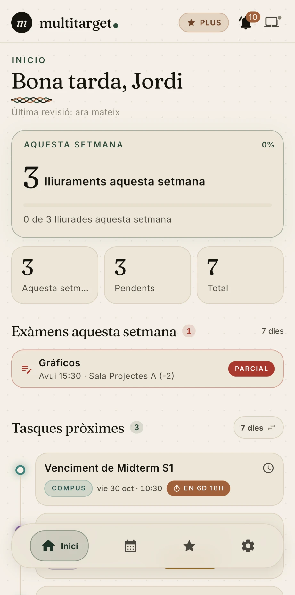
  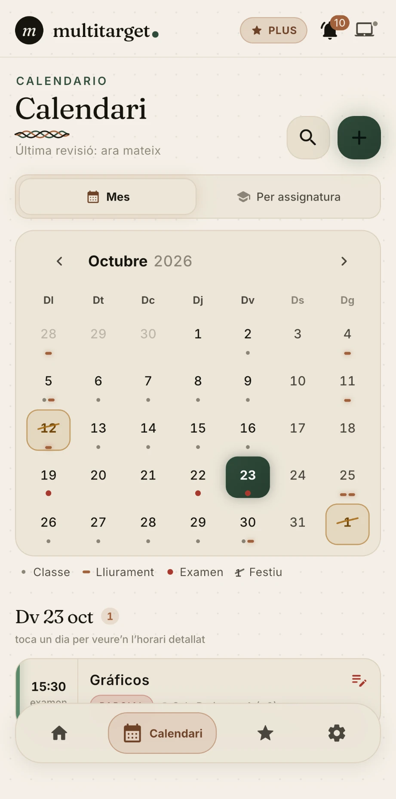
  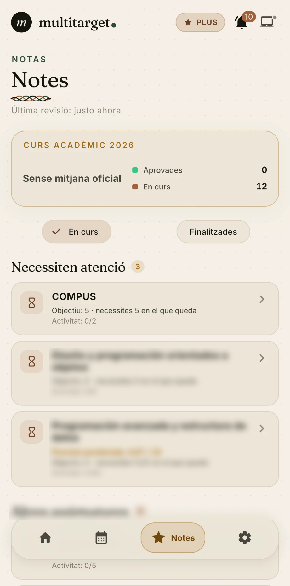
  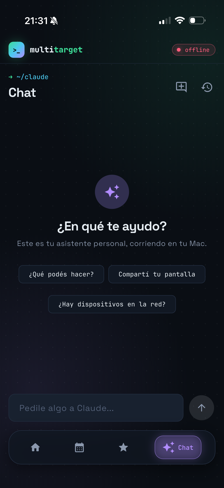

---

## Qué hace

### Inicio

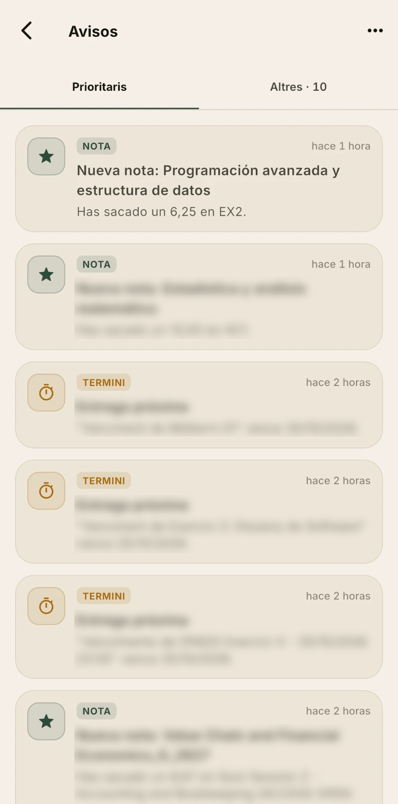

- Resumen de la semana: cuántas entregas hay en los próximos 7 días, cuántas quedan
  pendientes y una barra de progreso de las entregadas.
- Lista de próximas tareas.
- **Avisos**: una campanita junto al saludo abre una bandeja con dos pestañas,
  *Prioritarios* (todo lo de clase: entregas nuevas, notas nuevas, posibles tareas, entregas
  que vencen pronto) y *Otros*. Los avisos se guardan aunque la app esté cerrada y también
  llegan como notificación push.

 

### Calendario

- **Vista de mes** con las entregas y las clases del horario marcadas en cada día. Al tocar un
  día se abre esa semana en detalle, hora por hora.
- **Vista por asignatura**, con cada entrega y el tiempo que queda.
- Búsqueda y entregas añadidas a mano.
- **Posibles tareas**: detecta enunciados publicados como archivos sueltos en el campus (fuera
  del sistema de entregas oficial) y los propone para que confirmes si son tarea.
- Las entregas se sincronizan solas desde el campus virtual, incluidos los cuestionarios, y
  se marcan como entregadas cuando las envías.

 

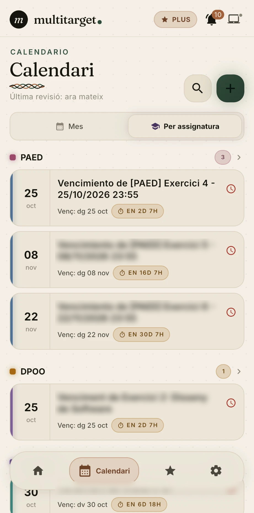
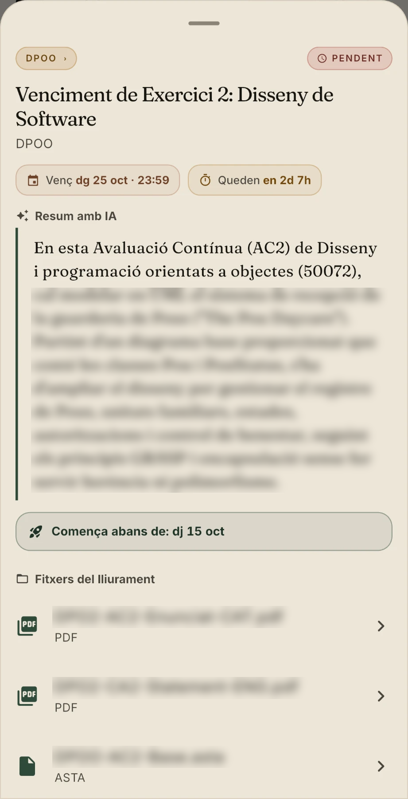

**Detalle de cada entrega**
- Fecha de entrega y cuenta atrás.
- **Resumen con IA** del enunciado: Claude lee los PDF de la entrega y explica qué hay que
  hacer.
- **"Empezar antes de"**: fecha recomendada para empezar, con margen de sobra antes de la
  fecha límite.
- Los archivos de la entrega, que se abren directamente desde la app.

 

### Notas

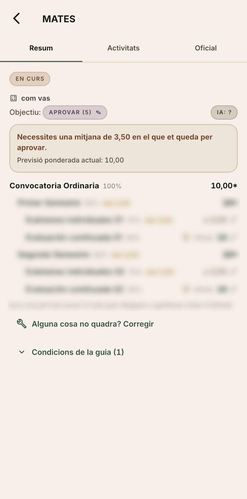

- Notas oficiales sincronizadas desde el portal de la universidad: media, aprobadas,
  suspendidas y pendientes.
- Notas parciales del campus virtual (cuestionarios, prácticas) en cada asignatura.
- **"Cómo vas"**: el sistema de evaluación de cada asignatura (sacado automáticamente de su
  Guía Académica, con pesos y notas mínimas). Fijas un objetivo, por ejemplo aprobar o un 7,
  apuntas las notas que ya sabes y te dice **qué media necesitas en lo que queda**. También
  muestra si la asignatura permite usar IA.

 

### Biblioteca
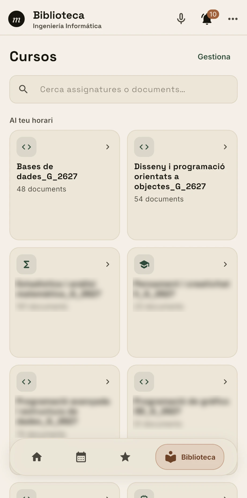
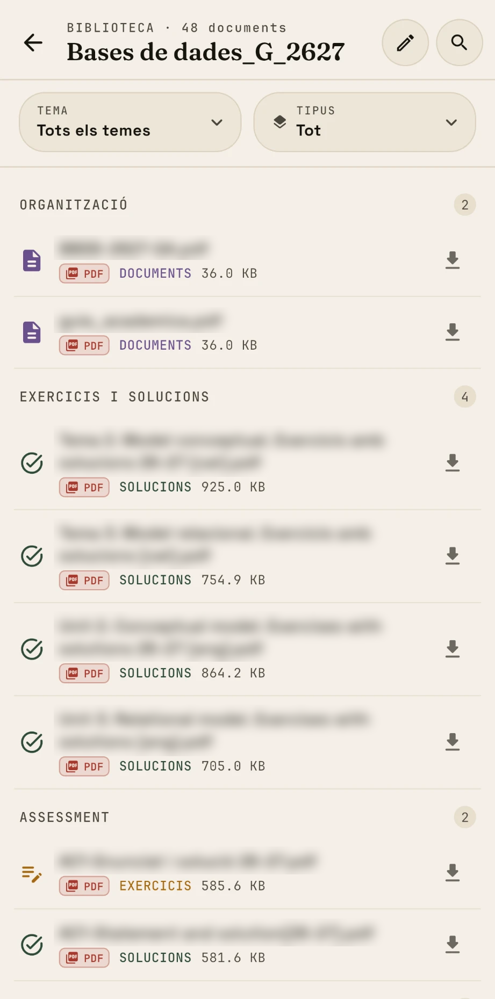

- Los archivos de cada asignatura del campus virtual, ordenados por tema y por tipo
  (apuntes, ejercicios, soluciones, evaluación), con buscador.
- Las asignaturas del horario salen primero.
- Los archivos se abren directamente desde el campus virtual con la sesión del propio
  estudiante: la app no guarda copias.
- *(Los nombres de los archivos están difuminados.)*

 

### Cuenta y privacidad
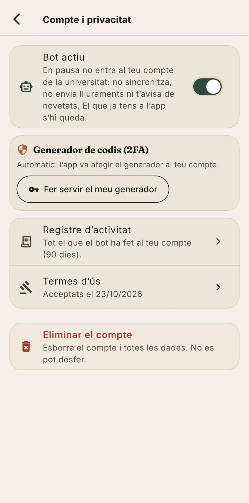

- Términos de uso al crear la cuenta: el estudiante autoriza expresamente que el bot entre en
  su nombre, y queda guardado qué versión aceptó y cuándo.
- **Pausar el bot** en cualquier momento: deja de entrar en la cuenta de la universidad.
- **Registro de actividad**: todo lo que el bot ha hecho en la cuenta (inicios de sesión,
  avisos enviados, entregas), que el estudiante puede consultar y borrar.
- Generador de códigos de verificación (2FA) automático o propio.
- **Eliminar la cuenta** con todos sus datos.

 

### Chat con Claude

- Un chat con Claude que tiene acceso a mis datos de la universidad: "¿qué tengo que entregar
  esta semana?", "¿cuánto necesito en el examen de X?", "apúntame una entrega para el
  viernes".
- Claude corre a través de un agente propio en mi ordenador, que le da herramientas (tool
  use) para leer y modificar entregas y notas. Solo puede acceder a mis datos.
- Varias conversaciones con historial.

 

### Versión de escritorio
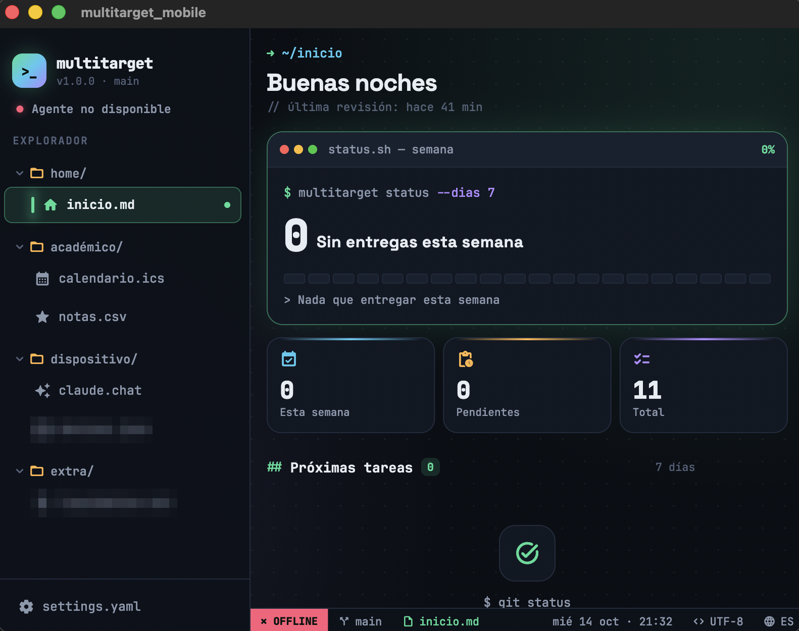

En pantallas anchas la app cambia a un diseño de editor de código: un explorador lateral donde
cada sección es un "archivo" (`inicio.md`, `calendario.ics`, `notas.csv`, `claude.chat`) y una
barra de estado abajo.

### Además
- **Widget "Próximo"** en iPhone y Mac con las próximas entregas y la siguiente clase.
- **Notificaciones** con la app cerrada (entregas nuevas, notas nuevas, posibles tareas) y
  recordatorios 24 h y 2 h antes de cada entrega.
- **Funciona sin conexión** con la última copia de los datos, y se actualiza en tiempo real
  (~1 s) cuando llega algo nuevo.

### Módulos
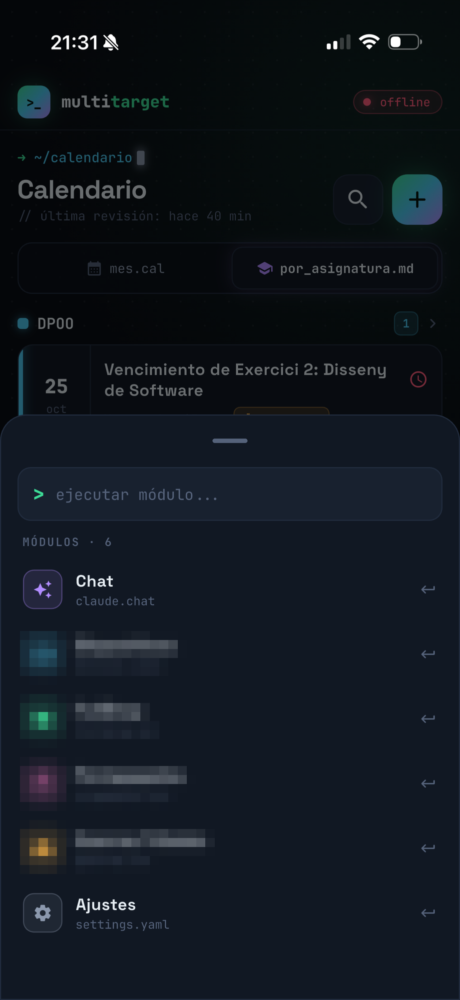

El núcleo es lo de arriba: Inicio, Calendario, Notas, el Chat y Ajustes. El resto de cosas que
hace la app son **módulos**, extras que se enchufan y se quitan sin tocar el núcleo. En el
móvil salen en el menú **Más**, una paleta de comandos (`> ejecutar módulo...`) que se puede
filtrar escribiendo. En escritorio salen en las carpetas `dispositivo/` y `extra/` del
explorador. *(Los míos están pixelados: son privados.)*

Hay dos tipos:

- **Módulos del agente**, que corren en el ordenador. Cada uno implementa un contrato común
  (`IAgentModule`): declara en qué sistemas operativos funciona, qué acciones ofrece (cada una
  con el esquema de sus parámetros) y cómo ejecutarlas. El agente los expone por su API y se
  los pasa a Claude como herramientas, así que el chat puede usarlos sin que el puente con
  Claude sepa nada de ellos. La app solo enseña su sección si el agente dice que ese módulo
  está instalado, y los que solo funcionan en un sistema (por ejemplo, solo Windows) ni
  siquiera se compilan en el otro.
- **Módulos de la app**, que son autocontenidos. Cada uno vive entero en su carpeta
  (`lib/modules/<nombre>/`): su pantalla, su configuración (dentro de su propia página, no en
  Ajustes) y su SQL de Supabase. Declara cómo se muestra en el menú (nombre, icono,
  "archivo" y color), y la lista de módulos la genera un script a partir de las carpetas que
  existen. **Para quitar un módulo basta con borrar su carpeta** y volver a generar la lista:
  la app sigue compilando.

Los módulos también pueden dejar avisos en la bandeja de Inicio (en *Otros*), incluso
programas externos sin sesión iniciada, con un token por cuenta, y esos avisos llegan como
notificación push.

 

---

## Cómo está hecho

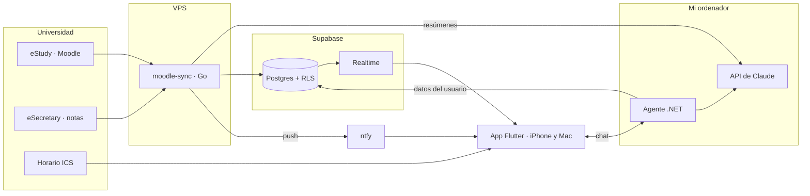

| Parte | Tecnología | Qué hace |
|---|---|---|
| **App** | Flutter (Dart), Material 3 con tema propio estilo terminal | iPhone y Mac con la misma base de código; diseño adaptable (móvil con dock flotante y paleta de comandos, escritorio con explorador lateral) |
| **moodle-sync** | Go, servicio systemd en un VPS | Inicia sesión en el SSO de la universidad (incluido el código de un solo uso, leído del correo por IMAP), sincroniza entregas, cuestionarios, recursos y notas, saca el sistema de evaluación de las Guías Académicas y pide a Claude los resúmenes |
| **Base de datos** | Supabase: Postgres con Row Level Security, Realtime y triggers | Cada usuario solo ve sus filas; los triggers generan los avisos automáticamente |
| **Agente** | C# / .NET 10, macOS y Windows | API HTTP local con un contrato de módulos (`IAgentModule`); conecta Claude (tool use) con las herramientas de cada módulo |
| **IA** | Claude (Anthropic) | Resúmenes de enunciados, fechas recomendadas y el chat con herramientas |
| **Push** | ntfy | Notificaciones sin cuentas de APNs/FCM |
| **Widget** | SwiftUI (WidgetKit) | Compartido entre iOS y macOS |

Hay tests unitarios en las partes delicadas: el parseo de ICS y del sistema de evaluación, los
modelos de entregas y notas, la detección de cuestionarios y enunciados, y las herramientas del
agente.
